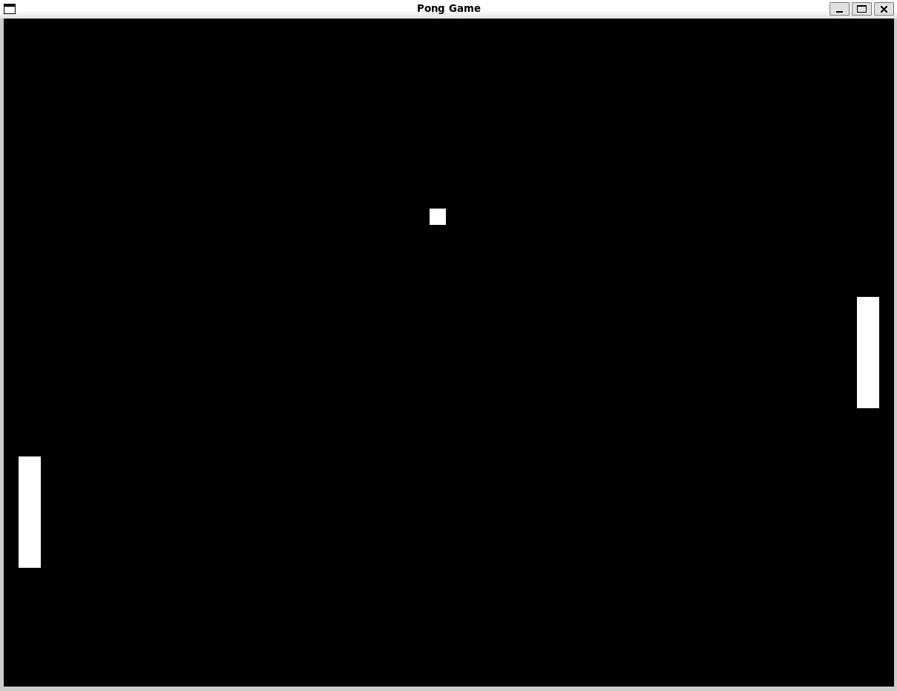

# Pong

Classic two-player Pong in C with SDL2. Two paddles, one ball, one keyboard.

I built it to practice a real-time game loop: input, movement, collisions, drawing.

<p align="center">
  
</p>

## How it works

Every frame, about every 4 ms, the game does the same four things:

1. **Input**: read which keys are held and set each paddle's speed.
2. **Move**: move the paddles (they stop at the top and bottom edges) and the ball. The ball bounces off the top and bottom walls.
3. **Collide**: if the ball's rectangle overlaps a paddle's rectangle, it bounces back. If it leaves the screen on the left or right, it goes back to the center with a random direction.
4. **Draw**: clear the screen, draw the paddles and the ball, show the frame.

There's no score yet. A missed ball just restarts from the center.

## Requirements

- **GCC** and **SDL2** on Linux. On Windows, use WSL with Ubuntu.

## Run

In Ubuntu (or WSL), from the project folder:

```bash
sudo apt install libsdl2-dev
gcc pong.c -o pong -lSDL2
./pong
```

## Controls

| Player | Up | Down |
|---|:---:|:---:|
| Left paddle | `W` | `S` |
| Right paddle | `↑` | `↓` |

Close the window to quit.

## Code

Everything is in `pong.c`:

```
Paddle, Ball               position, size, speed
keyHandler()               W/S and ↑/↓ into paddle speed
move_paddle(), move_ball() movement and wall bounces
ball_paddle_collision()    rectangle overlap check and bounce
reset_ball_position()      ball back to center, random direction
main()                     the game loop
```
